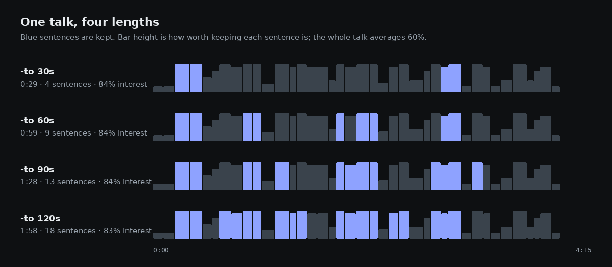
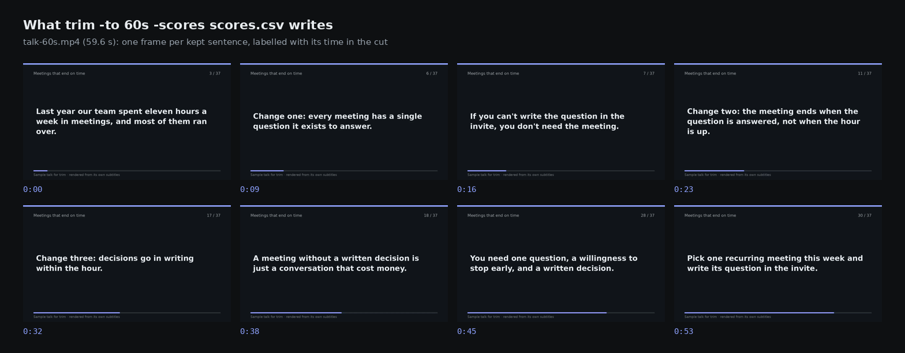
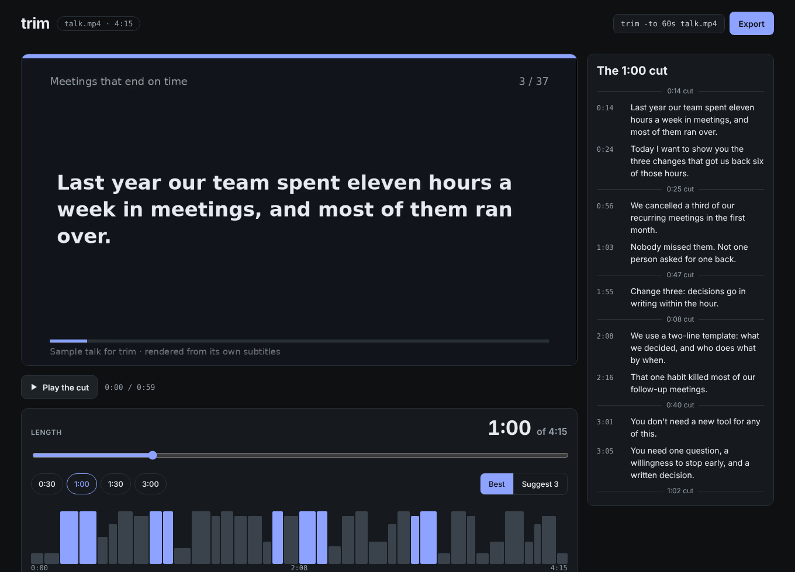
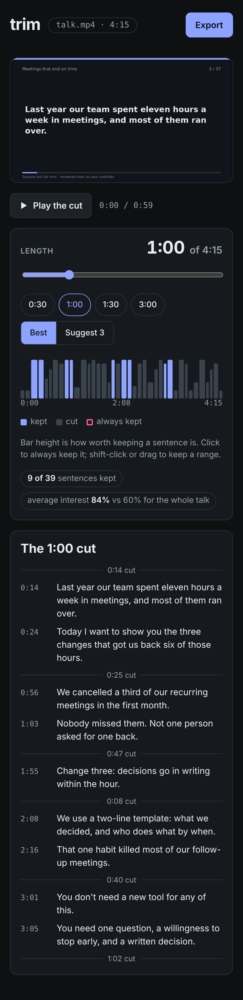
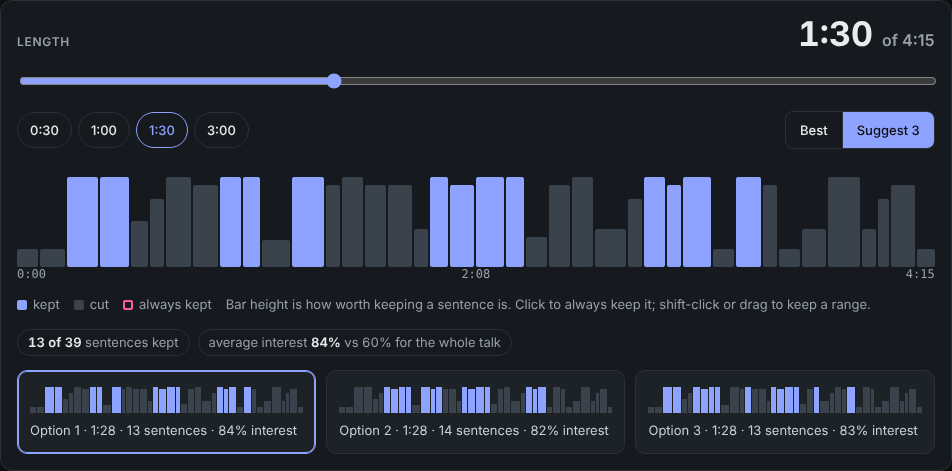
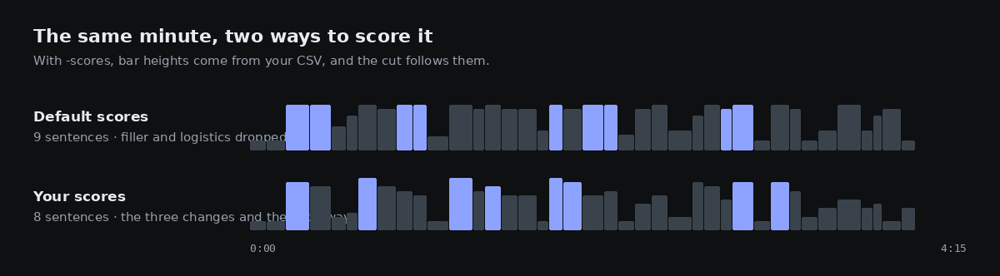

# trim

Cut a talk, podcast or video to an exact length, keeping the parts most worth keeping.


```sh
brew install vinodhalaharvi/tap/trim

trim -to 60s talk.mp4                 # the best minute, as talk-60s.mp4
trim -to 90s -suggest 3 talk.mp4      # three different 90-second cuts
trim -to 2m -keep 4:05 podcast.mp3    # always keep what is said at 4:05
trim serve talk.mp4                   # pick the length in your browser
```

trim works sentence by sentence, so nobody is cut off mid-word, and every output comes with subtitles re-timed to match.

## Try it on the sample talk

The `examples` folder has a 4-minute sample talk, *Meetings that end on time*, with its subtitles. Every image on this page was made from it with the commands shown.

```sh
git clone https://github.com/vinodhalaharvi/trim && cd trim/examples
trim -to 60s talk.mp4
```

```
4:03 · 39 sentences from talk.srt
talk-60s.mp4  1:00  9 of 39 sentences · 84% interest (whole talk 60%)
```

Add `-dry-run` to see which sentences it kept without writing any video:

```
$ trim -to 60s -dry-run talk.mp4
talk-60s.mp4  1:00  9 of 39 sentences · 84% interest (whole talk 60%)
       0:14  Last year our team spent eleven hours a week in meetings, and most of them ran over.
       0:24  Today I want to show you the three changes that got us back six of those hours.
       0:56  We cancelled a third of our recurring meetings in the first month.
       1:03  Nobody missed them. Not one person asked for one back.
       2:08  We use a two-line template: what we decided, and who does what by when.
       2:16  That one habit killed most of our follow-up meetings.
       2:55  And our survey score for 'meetings are worth my time' doubled.
       3:01  You don't need a new tool for any of this.
       3:05  You need one question, a willingness to stop early, and a written decision.
```

The mic check, the slide fumbling and the "um, so, where was I" are gone; the numbers and the takeaway stay.

## Any length you like

Each length is chosen fresh: a shorter cut is not just a longer one trimmed at the end.



## What you get

A normal video file of the kept sentences, joined in order, plus `talk-60s.srt` with the subtitles moved to their new times. Cuts land exactly on video frames so sound and picture stay in sync, and the audio fades for 30 ms at each cut so there are no clicks.



## Edit in your browser

```sh
trim serve talk.mp4
```

<p>


</p>

- **Drag the length** and the cut updates instantly; the transcript on the right shows exactly what stays and how much was cut between.
- **Click a sentence** on the timeline to always keep it. **Shift-click** or **drag across the timeline** to keep a whole range. If what you keep runs longer than the length, the length grows to fit.
- **Play the cut** previews only the kept parts, with captions.
- **Export** writes the file and its subtitles beside the original.

Everything runs on your computer; nothing is uploaded.

## Three different cuts

`-suggest 3` (or **Suggest 3** in the editor) gives you real alternatives, not the same cut with one sentence swapped: each option differs from the others in at least a third of its sentences.

```
$ trim -to 90s -suggest 3 talk.mp4
talk-90s-1.mp4  1:29  13 of 39 sentences · 83% interest (whole talk 60%)
talk-90s-2.mp4  1:29  13 of 39 sentences · 83% interest (whole talk 60%)
talk-90s-3.mp4  1:29  13 of 39 sentences · 84% interest (whole talk 60%)
```



## Always keep a moment

`-keep` takes times or ranges. A time that falls in a pause picks the nearest sentence.

```
$ trim -to 60s -keep 1:30 -dry-run talk.mp4
talk-60s.mp4  1:00  9 of 39 sentences · 84% interest (whole talk 60%)
       0:14  Last year our team spent eleven hours a week in meetings, and most of them ran over.
       0:24  Today I want to show you the three changes that got us back six of those hours.
       0:56  We cancelled a third of our recurring meetings in the first month.
       1:03  Nobody missed them. Not one person asked for one back.
       1:17  Change two: the meeting ends when the question is answered, not when the hour is up.
       1:26  Calendar slots are a ceiling, not a target.
       1:30  Our average meeting went from fifty-two minutes to twenty-one.
       3:01  You don't need a new tool for any of this.
       3:05  You need one question, a willingness to stop early, and a written decision.
```

```sh
trim -to 3m -keep 0:00-0:30,12:10 keynote.mp4    # the opening and one quote
```

## Better cuts with your own scores

trim rates every sentence from 0 to 1. Out of the box it uses a simple rule of thumb: it marks down filler words ("um", "you know"), talk about the talk ("can everyone hear me", "next slide", "thank you"), slow stretches and fragments, and favours sentences with specific numbers. That removes the dead weight but knows nothing about what you actually said.

For better cuts, give trim your own scores. `trim score` writes them to a CSV you can edit by hand or fill in with any tool, such as a language model asked to rate how well each sentence stands on its own:

```
$ trim score talk.srt > scores.csv
index,start,end,score,text
1,"00:00:00,600","00:00:06,450",0.02,"Okay, is this mic on? Can everyone at the back hear me?"
2,"00:00:07,000","00:00:13,850",0.02,"Great. Let me just get my slides up, one second."
3,"00:00:14,400","00:00:23,250",0.85,"Last year our team spent eleven hours a week in meetings, and most of them ran over."
```

Scores can be any non-negative numbers; trim rescales them. With hand-written scores (`examples/scores.csv`, 0 to 10), the same minute becomes the talk's actual argument, its three changes and the call to action:

```
$ trim -to 60s -scores scores.csv -dry-run talk.mp4
talk-60s.mp4  1:00  8 of 39 sentences · 92% interest (whole talk 52%)
       0:14  Last year our team spent eleven hours a week in meetings, and most of them ran over.
       0:42  Change one: every meeting has a single question it exists to answer.
       0:49  If you can't write the question in the invite, you don't need the meeting.
       1:17  Change two: the meeting ends when the question is answered, not when the hour is up.
       1:55  Change three: decisions go in writing within the hour.
       2:00  A meeting without a written decision is just a conversation that cost money.
       3:05  You need one question, a willingness to stop early, and a written decision.
       3:20  Pick one recurring meeting this week and write its question in the invite.
```



## Podcasts and other audio

Audio files work the same way; the output keeps the input's format.

```sh
trim -to 5m episode.mp3 episode.srt     # writes episode-300s.mp3 and episode-300s.srt
```

## What it needs

- **ffmpeg**, which Homebrew installs with trim.
- **Subtitles** as `.srt` or `.vtt`. trim looks for one beside the video with the same name (`talk.srt` for `talk.mp4`), or pass it after the video. No subtitles yet? Any transcriber works, for example [whisper](https://github.com/openai/whisper):

  ```sh
  whisper talk.mp4 --output_format srt
  ```

## Flags

| Flag | Meaning |
|---|---|
| `-to LENGTH` | target length: `60s`, `1m30s`, `90` or `1:30` (required) |
| `-keep TIMES` | always keep the sentences at these times or ranges: `0:12,4:05-5:10` |
| `-suggest N` | write N different cuts: `talk-90s-1.mp4`, `talk-90s-2.mp4`, … |
| `-scores FILE` | sentence scores from `trim score` |
| `-o FILE` | output file (default `NAME-60s.EXT` beside the input) |
| `-dry-run` | print the kept sentences without writing any media |

`trim serve` takes `-port`, `-no-open` and `-scores`.

## How it works

Picking sentences to fill a length is a knapsack problem. trim solves it exactly with a dynamic program from [dyna](https://github.com/vinodhalaharvi/dyna), and indexes the answer by length, so one solve answers every length at once. That is why dragging the length in the editor is instant; a 30-minute talk solves in about 0.3 seconds. Rendering seeks to each kept stretch and works in small batches, so memory stays around 100 MB however long the video or the edit list. Details: [docs/how-it-works.md](docs/how-it-works.md).

## License

MIT. The sample talk in `examples` was written for this project and may be reused freely.
